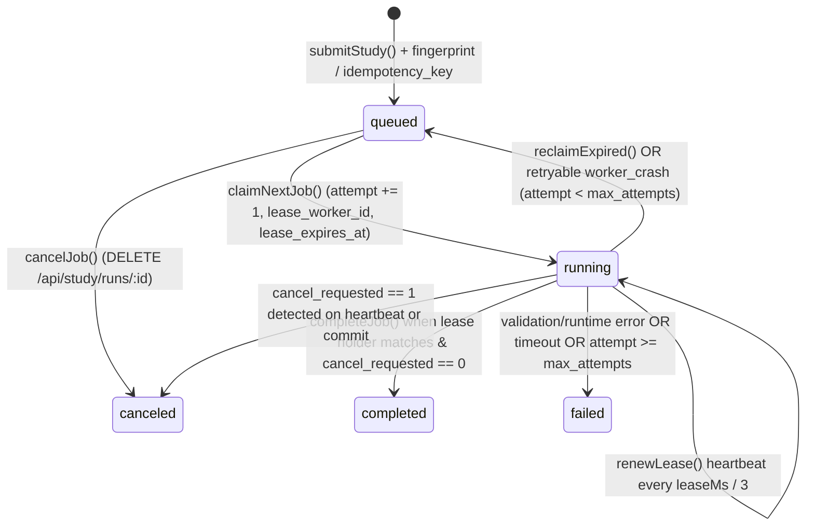

# Umbra-X Reliability & Fault-Tolerance Engineering

## 1. Study Job Lifecycle & Delivery Semantics

[`server/queue.mjs`](file:///c:/Users/ajite/Desktop/UmbraX/server/queue.mjs) (`StudyQueueStore`) and [`server/worker.mjs`](file:///c:/Users/ajite/Desktop/UmbraX/server/worker.mjs) (`createStudyWorkerLoop`) implement **at-least-once leased job execution with idempotent deduplication**:



### Key Correctness Invariants Verified in Code
1. **Atomic Lease Acquisition (`claimNextJob`):** Uses `BEGIN IMMEDIATE` transactions (`_withTx`) to call `reclaimExpired(now)` first, select the oldest `state='queued' AND cancel_requested=0` row, and transition `state='running'`, incrementing `attempt`, and setting `lease_worker_id` + `lease_expires_at = now + leaseMs`.
2. **Zombie Worker Lease Recovery (`reclaimExpired`):** Any `running` job whose `lease_expires_at <= now` is reclaimed:
   - If `cancel_requested = 1`, it transitions cleanly to `canceled`.
   - If `attempt < max_attempts` (default `3`), it returns to `queued` with `error = "Worker lease expired (lease_worker_id); requeued automatically."`.
   - If `attempt >= max_attempts`, it is dead-lettered to `failed` (`"Exceeded max_attempts (...) after worker lease expiration."`) instead of retrying forever.
3. **Idempotency Keys & Fingerprint Reuse (`submitStudy`):**
   - Canonical request fingerprint (`SHA-256` of `input`) deduplicates identical non-failed, non-canceled jobs across concurrent submissions.
   - Supplying an `Idempotency-Key` header enforces strict payload matching: concurrent requests with the same key and identical fingerprint return the existing job ID (`reused: true`, HTTP `200`), while reusing an existing `Idempotency-Key` with a different payload throws `IdempotencyConflictError` (**HTTP `409 Conflict`**).
4. **Cancellation Safety Against Late Completion:** `cancelJob()` sets `cancel_requested=1` (and immediately marks `queued` jobs `canceled`). Running workers poll `renewLease()` every `max(100, floor(leaseMs / 3))` ms; if `cancelRequested` is true, the worker terminates the `worker_threads` child. Even if a slow worker races to `completeJob()` before noticing cancellation, `completeJob()` checks `current.state === 'running' && current.lease_worker_id === workerId && current.cancel_requested === 0` inside `BEGIN IMMEDIATE` and discards/unlinks the artifact if false.
5. **Atomic Artifact Writes & Corruption Detection:**
   - `completeJob()` computes `SHA-256`, writes `<id>.json.tmp-<pid>-<rand>` first, atomically `renameSync()`s to `<id>.json`, and records `artifact_sha256` in SQLite. Orphan `.tmp-` files left after `SIGKILL` crashes are purged on worker startup via `cleanupStaleTempFiles()`.
   - `readVerifiedResult()` verifies the path remains inside `artifactsDir`, confirms the file exists on disk, recomputes `SHA-256`, and throws `ArtifactIntegrityError` (`HTTP 500`, incrementing `umbrax_data_version_errors_total`) if altered.
6. **Per-Job Timeout & Graceful Shutdown:** Each worker thread execution enforces `timeout_ms` (`120_000` ms default), terminating runaway computations. Both API and standalone worker trap `SIGINT` and `SIGTERM` (`stop()` / `close()`), draining HTTP servers and terminating active threads cleanly (`stop()` closes SQLite handles).

---

## 2. Observability & Distributed Tracing

[`server/telemetry.mjs`](file:///c:/Users/ajite/Desktop/UmbraX/server/telemetry.mjs) and [`infra/observability/`](file:///c:/Users/ajite/Desktop/UmbraX/infra/observability) provide structured observability without third-party agent lock-in:

- **Prometheus Metrics (`GET /metrics`):** Exports `umbrax_http_requests_total`, `umbrax_http_request_duration_ms`, `umbrax_study_submissions_total`, `umbrax_study_jobs_total`, `umbrax_study_job_duration_ms`, `umbrax_study_job_retries_total`, `umbrax_study_queue_depth{state=...}`, `umbrax_model_invocations_total`, `umbrax_model_latency_ms`, `umbrax_rag_queries_total`, `umbrax_rag_latency_ms`, `umbrax_cache_events_total`, `umbrax_response_cache_entries`, `umbrax_auth_rejections_total`, `umbrax_browser_telemetry_events_total`, `umbrax_browser_compute_duration_ms`, `umbrax_wasm_fallbacks_total`, and `umbrax_data_version_errors_total`.
- **Alert Rules ([`infra/observability/prometheus/alert_rules.yml`](file:///c:/Users/ajite/Desktop/UmbraX/infra/observability/prometheus/alert_rules.yml)):** Fires on 5xx rate spikes (`UmbraXApiHighErrorRate`), study queue backlog `> 20` for 5m (`UmbraXStudyQueueBacklog`), and any artifact/checksum mismatch (`UmbraXArtifactIntegrityViolation`).
- **OTLP-Shaped Spans & W3C `traceparent`:** HTTP handlers parse incoming `traceparent`, attach `x-correlation-id` and `traceparent` response headers, record spans into `TraceRecorder`, and propagate `trace_id` into queued worker jobs (`study.execute`).

### Verified Sample Trace Span (`research/benchmarks/phase5_perf_report.json`)
Excerpted directly from [`research/benchmarks/phase5_perf_report.json`](file:///c:/Users/ajite/Desktop/UmbraX/research/benchmarks/phase5_perf_report.json#L272-L316):

```json
{
  "resource": { "serviceName": "umbra-api" },
  "traceId": "22222222222222222222222222222200",
  "spanId": "e02e3efddfd04c13",
  "name": "study.execute",
  "durationMs": 308.266,
  "status": { "code": "OK" },
  "attributes": {
    "jobId": "b631073a-0916-46c0-a1fd-5131cb9eab62",
    "kind": "compare",
    "attempt": 1,
    "workerId": "worker-42540-0c91ab",
    "committed": true,
    "artifactSha256": "c84fa352bf25dc8ada1f95351aef511fc5ca28cfa0d148d60149984b9feabb08",
    "durationMs": 303.3
  }
}
```

---

## 3. Executed Failure-Injection & Resilience Tests

All crash, corruption, cancellation, idempotency, auth, and overload behaviors are exercised in [`server/phase5.test.mjs`](file:///c:/Users/ajite/Desktop/UmbraX/server/phase5.test.mjs) (executed cleanly via `node --test server/agent.test.mjs server/research.test.mjs server/phase5.test.mjs`):

| Scenario Tested | Mechanism Exercised | Verified Outcome |
| :--- | :--- | :--- |
| Dead worker lease + orphan `.tmp-crash` file | 80 ms lease expires, `cleanupStaleTempFiles(0)`, `workerB.processOnce()` | Temp file deleted, job reclaimed (`attempt: 2`), completed cleanly with verified 64-hex SHA-256 |
| Exhausted retry budget (`maxAttempts: 1`) | Worker A dies without renewing 40 ms lease -> `reclaimExpired()` | `deadLettered: 1`, state transitions to `failed` with max_attempts reason |
| On-disk artifact tampering | Corrupt byte in `<id>.json` -> `readVerifiedResult()` | Throws `ArtifactIntegrityError` (`HTTP 500`), increments `umbrax_data_version_errors_total` |
| Cancel race vs late completion | `cancelJob()` during `running` -> `renewLease()` -> late `completeJob()` | `cancelRequested: true`, late `completeJob().committed === false`, artifact unlinked, state remains `canceled` |
| Concurrent burst with identical `Idempotency-Key` | 4 parallel `POST /api/study/runs` | Single job UUID created across all 4 responses; payload mismatch returns `HTTP 409` |
| Rate limiter exhaustion | Repeated `POST /api/study/runs` exceeding `rateMax: 18` | Returns `HTTP 429` with numeric `Retry-After` header |
