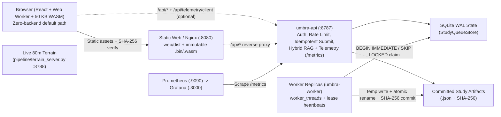

# Umbra-X System Architecture

Umbra-X separates **zero-backend interactive planetary mission screening** (the public static build and Web Worker + Rust/WASM engine) from **optional durable background study execution, scientific retrieval, and telemetry** (`server/` + `infra/`). Lightweight browser geometry stays on the user's device instead of paying network serialization and centralized server compute costs.

---

## 1. Workload Separation & Hosting Matrix

| Layer | Workloads & Components | Primary Location | Runs Without Backend? | Notes & Guarantees |
| :--- | :--- | :--- | :--- | :--- |
| **Static Scientific Data Distribution** | Immutable `planner-release` GeoTIFF-derived horizons (`horizons.bin`, content-addressed `<sha256>.bin`), DE440 SPICE vector table (`829,536` bytes), Vite web bundle, `50,415`-byte `umbra_core.wasm` | [`web/public/data/planner-release/`](file:///c:/Users/ajite/Desktop/UmbraX/web/public/data/planner-release), [`infra/docker/nginx.conf`](file:///c:/Users/ajite/Desktop/UmbraX/infra/docker/nginx.conf) | **Yes** | `<sha256>.bin` immutable `Cache-Control: max-age=31536000, immutable`; `.json` manifests `max-age=60, must-revalidate`. Client verifies SHA-256 on load via [`web/src/planner/data.ts`](file:///c:/Users/ajite/Desktop/UmbraX/web/src/planner/data.ts). |
| **Interactive Local Mission Calculations** | 2-scenario compare, 961-pad regional scans (`48 km` / `96 km`, `0σ` / `2σ`), counterfactual Mission Recovery & 7-objective Pareto frontier, 3D Three.js / 2D polar SVG inspection, deterministic Decision Certificate export | [`web/src/planner/planner.worker.ts`](file:///c:/Users/ajite/Desktop/UmbraX/web/src/planner/planner.worker.ts), [`web/src/planner/wasmSearch.ts`](file:///c:/Users/ajite/Desktop/UmbraX/web/src/planner/wasmSearch.ts), [`rust/umbra-core/`](file:///c:/Users/ajite/Desktop/UmbraX/rust/umbra-core) | **Yes** | Executes inside a dedicated browser Web Worker using `umbra_core.wasm` with automatic bit-identical TypeScript fallback (`wasm_fallback` telemetry if instantiation fails). |
| **Durable Background Scientific Studies** | Multi-site/multi-day queued sweeps submitted via `POST /api/study/runs`, idempotent dedupe, lease recovery, SHA-256 JSON artifacts | [`server/server.mjs`](file:///c:/Users/ajite/Desktop/UmbraX/server/server.mjs), [`server/queue.mjs`](file:///c:/Users/ajite/Desktop/UmbraX/server/queue.mjs), [`server/worker.mjs`](file:///c:/Users/ajite/Desktop/UmbraX/server/worker.mjs), [`server/study.mjs`](file:///c:/Users/ajite/Desktop/UmbraX/server/study.mjs) | Optional | Decoupled API + poll-based worker processes using `node:sqlite` WAL leases (`BEGIN IMMEDIATE`) across shared volume state (`umbra-state`). |
| **AI Inference & Scientific Retrieval** | Constrained tool-calling co-pilot (`POST /api/research/ask`) and hybrid BM25 + dense Qdrant RRF lookup (`POST /api/research/evidence`) over 169 NASA/Umbra-X chunks | [`server/researchAgent.mjs`](file:///c:/Users/ajite/Desktop/UmbraX/server/researchAgent.mjs), [`server/rag.mjs`](file:///c:/Users/ajite/Desktop/UmbraX/server/rag.mjs), [`server/tools.mjs`](file:///c:/Users/ajite/Desktop/UmbraX/server/tools.mjs) | Graceful fallback | Frontend keeps deterministic explanation fallback; server `ResearchCorpusRetriever` falls back to pure-JS BM25 when `UMBRA_DISABLE_PYTHON_RAG=1` (as in Docker Compose). |
| **Study Persistence & Atomic Artifacts** | Job metadata table (`studies`) + atomic `.tmp -> renameSync` JSON result artifacts with stored SHA-256 verification on read | [`server/queue.mjs`](file:///c:/Users/ajite/Desktop/UmbraX/server/queue.mjs) | Optional | `readVerifiedResult()` recomputes SHA-256 from disk and raises `ArtifactIntegrityError` (`HTTP 500`) + increments `umbrax_data_version_errors_total` on tampering or missing artifact files. |
| **Scientific Artifact Versioning & Integrity** | End-to-end validation of release manifests, 3-site shared DE440 vector binding, WASM hash, and composite `releaseFingerprint` | [`infra/scripts/verify_release_integrity.mjs`](file:///c:/Users/ajite/Desktop/UmbraX/infra/scripts/verify_release_integrity.mjs), [`pipeline/check_planner_release.py`](file:///c:/Users/ajite/Desktop/UmbraX/pipeline/check_planner_release.py) | Build / CI gate | Enforced in [`.github/workflows/planner-checks.yml`](file:///c:/Users/ajite/Desktop/UmbraX/.github/workflows/planner-checks.yml) and [`.github/workflows/planner-release.yml`](file:///c:/Users/ajite/Desktop/UmbraX/.github/workflows/planner-release.yml). |

---

## 2. Service & Deployment Topology

### Runtime Modes
1. **Static Public Mode (Zero Compute Cost):** Serve `web/dist/` from any static HTTPS bucket or Nginx. `planner.worker.ts` computes mission compare/recovery locally, and `reportTelemetry()` silently ignores failed `POST /api/telemetry/client` calls without degrading UI functionality.
2. **Local Integrated Dev/Preview Mode:** [`web/vite.config.ts`](file:///c:/Users/ajite/Desktop/UmbraX/web/vite.config.ts) proxies `/api/study`, `/api/research`, `/api/telemetry`, `/healthz`, `/readyz`, and `/metrics` to `http://127.0.0.1:8787`. With `UMBRA_EMBEDDED_WORKER=1` (default for standalone `node server/server.mjs`), the API process hosts a single in-process `createStudyWorkerLoop`.
3. **Containerized Multi-Worker Compose Topology:** [`infra/docker-compose.yml`](file:///c:/Users/ajite/Desktop/UmbraX/infra/docker-compose.yml) sets `UMBRA_EMBEDDED_WORKER=0` and `UMBRA_TERRAIN_URL=http://terrain:8788` on `api`, mounts shared volume `umbra-state:/data`, runs `worker` at `replicas: 2`, provisions `terrain` (`infra/docker/Dockerfile.terrain` serving `pipeline/terrain_server.py` on port `8788` with healthcheck), and runs `prom/prometheus:v2.55.1` + `grafana/grafana:11.3.0`.
4. **Static Assets & Edge Routing:** [`infra/docker/nginx.conf`](file:///c:/Users/ajite/Desktop/UmbraX/infra/docker/nginx.conf) serves `web/dist/` cleanly with immutable caching on `<sha256>.bin`, SPA routing, and reverse proxying for `/api/` to the API tier.

---

## 3. Queue Backend Decision: Single-Node SQLite WAL

- **Implemented Runtime (`server/queue.mjs`):** Uses Node 24's built-in `node:sqlite` (`DatabaseSync`, WAL mode, `synchronous=NORMAL`, `busy_timeout=5000`) serialized with `BEGIN IMMEDIATE` write transactions. This avoids mandatory database daemons for local single-host Compose deployments (`umbra-state` shared volume) and deterministic CI integration tests.
- **Scale-Out Boundary:** SQLite WAL uses local POSIX/filesystem locks within the Compose host (`umbra-state`). Multi-region horizontal scaling across independent cloud VMs would swap the queue store adapter for an external transactional SQL backend (`SELECT ... FOR UPDATE SKIP LOCKED`) while keeping the worker lease contract identical.
